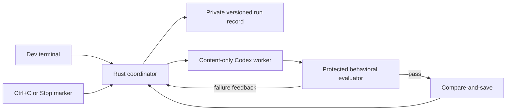

# Away pilot: implementation and Dev trial

Tested September 11, 2026. This is a working, bounded prototype of the
work → check → refine → next-task loop proposed in
[`AWAY_MODE_RESEARCH.md`](../AWAY_MODE_RESEARCH.md).

The subsequent [shared Away command](AWAY_CYCLE.md) supports bounded selected-file
projects through both Codex and Claude Code with mandatory review and a
controller-owned deadline. The disposable demo below remains available.

## What the pilot does

`iface away demo` creates a new disposable project containing three deliberately
broken Python utility functions. A Rust supervisor asks the installed Codex CLI
for file-content proposals, runs an independent evaluator, feeds failures back,
and applies only candidates that pass. It skips a deliberately blocked publishing
task and continues with independent local tasks. It finishes when the queue is
exhausted, or when Stop is requested.

The loop runs without user input after launch. This first pilot intentionally
accepts only a new demo directory; it does not select or modify existing projects.
It has a three-attempt limit per repair and a 180-second provider deadline per
attempt. It does not yet have an indefinite discovery loop or a desktop Away switch.

## Run it in Interface Dev

Open a **Terminal** workspace in Interface Dev. From a checkout containing this
change, run:

```sh
cargo run -p iface -- away demo --directory /private/tmp/away-trial-001 --model codex/gpt-5.6-terra
```

Choose a fresh absolute directory for every new trial. The installed
`~/.local/bin/codex` must already be authenticated. The model is an explicit CLI
selection; the pilot never silently switches it. No dependencies are added.

Use Ctrl+C in that terminal, or from another terminal:

```sh
cargo run -p iface -- away stop --directory /private/tmp/away-trial-001
cargo run -p iface -- away status --directory /private/tmp/away-trial-001
```

Stop prevents further admission and application at coordinator boundaries and
cancels the active worker. An already in-flight operation may complete before
Stop is observed. Read status to confirm completion. Partial accepted work is
retained. An uncertain provider outcome is reported as `unknown`, not success.

If the process crashes or its terminal is lost, inspect and then reconcile it:

```sh
cargo run -p iface -- away recover --directory /private/tmp/away-trial-001
```

Recovery takes the writer lease and marks interrupted work unknown and queued
work stopped. It never calls a provider or replays the interrupted attempt.
Reusing a run directory for `demo` is refused.

## Observed Dev results

The primary trial was launched through a new Interface Dev integrated terminal,
using the compiled feature-worktree CLI. The terminal visibly showed each
transition and the completed report. Dev was displaying version 0.3.106 at launch.

| Repair | Attempts | Result | Final behavioral assertions |
| --- | ---: | --- | ---: |
| Normalize tags | 1 | Accepted | 332 |
| Publish | 0 | Blocked; continued to the next task | — |
| Merge intervals | 3 | Rejected twice, then accepted | 333 |
| Summarize checks | 1 | Accepted | 330 |
| Total repairs | 5 provider calls | 3 accepted | **995** |

The first two interval proposals incorrectly merged intervals separated by one
integer. The evaluator supplied a concrete expected/actual counterexample. The
third proposal corrected the comparison. There was no human repair or prompt
between attempts, and the rejected candidates were never applied.

The final on-disk files were separately regraded: all 995 assertions passed.
Their bytes matched the accepted proposals and the compare-and-save SHA-256
receipts. The project contained only `README.md` and the three assigned modules.

The requested model was `codex/gpt-5.6-terra`, through installed Codex 0.154.0.
The provider returned no independent `actualModel` value, so exact server-side
model identity is not claimed. The five successful responses reported 28,856
input tokens, 1,546 output tokens, and 41.269 seconds summed worker elapsed time.
These are provider-reported metrics, not total wall time or a billing receipt;
USD cost was unavailable.

Evidence retained locally:

- Completed run: `/private/tmp/interface-away-demo-20260911/away-run.v1.json`.
- Repaired project: `/private/tmp/interface-away-demo-20260911/project/`.
- Captured input packets: the completed run's `packets/` directory.
- Cancellation run: `/private/tmp/interface-away-cancel-demo-20260911/away-run.v1.json`.
- Interrupted/recovered run: `/private/tmp/interface-away-stop-demo-20260911/away-run.v1.json`.

The cancellation trial was run through the CLI: tags had already been accepted;
Stop cancelled the interval worker, left its outcome unknown, and prevented the
checks task from starting. The process exited with the existing unknown-outcome
exit code 4 and persisted `finished: true, stopped: true`.

A separate Dev trial was interrupted while Dev restarted from 0.3.106 to 0.3.107.
Its writer lease was released; explicit recovery preserved the claimed first
attempt as unknown and stopped the remaining queue without dispatch. This is
evidence of fail-closed recovery, not evidence of surviving a Dev restart.

## Implementation



- [`interface-collaboration/src/away.rs`](../crates/interface-collaboration/src/away.rs)
  owns the queue, retry bounds, acceptance, cancellation boundaries and durable
  state. Dispatch is recorded before the provider is contacted. Proposals and
  hashes are persisted before evaluation; validation is persisted before apply.
- [`apps/iface/src/away.rs`](../apps/iface/src/away.rs) adapts the CLI, exclusive
  demo-directory creation, signal/Stop monitoring, provider and evaluator. Output
  is emitted and sanitized through `main.rs`.
- The existing `CliDelegate` and content-only Codex worker capture scoped inputs
  and return proposals. They do not run tools or write project files. Ordinary
  background pane delegation, which shared this runner, was retired on
  2026-10-14.
- The existing `delegation-quality-grade.py` is embedded unchanged. A separate
  isolated Python process checks a restricted AST and behavior, with a five-second
  host deadline and the evaluator's existing CPU bound. The worker can propose
  only its assigned existing file; it cannot change the evaluator or README.
- The separate `away-run.v1.json` uses `interface-storage` private directories,
  bounded reads, a single-writer lease and atomic compare-and-set writes. Existing
  desktop, provider and collaboration persisted schemas are unchanged.

## Verification and limits

Nine coordinator tests cover feedback repair, skipping blockers, the retry cap,
cancellation, uncertain provider/apply outcomes, lease/recovery behavior, stop
markers and evidence validation. Four CLI tests cover grammar, refusing existing
directories, actual evaluator behavior and proposal scope. `cargo xtask check --changed` passed for the Rust-only change: formatting,
workspace Clippy, Swift checks, the Rust suite (including all 13 new tests and
five existing real-PTY TUI tests), and all five smoke-pin tests.
The full Electron suite, packaged-app/signing/updater gates, and sleep/logout
trials were not run for this CLI-only pilot.

The protected evaluator is suitable for this small pure-function demo, not a
general sandbox for arbitrary repositories or build scripts. Passing these
behavioral checks is the pilot's acceptance rule; no independent model review,
formal proof or broad real-project quality claim is implied.

This process currently depends on its terminal and an awake, connected Mac. It
does not install a daemon, prevent sleep, survive logout, enforce a monetary
budget, discover tasks, resume crashed work, modify existing repos, merge branches,
publish, or deploy. Those broader capabilities remain follow-up work.

## Next implementation slice

Keep this coordinator and its evidence contract. Add an owner-selected project
and explicit task queue, an isolated Git worktree per candidate, a trusted
project-specific gate, and bounded retries with no-progress detection. Add a Dev
Away panel showing current work, accepted results, parked blockers and Stop.
Then move execution to a separate Rust supervisor with heartbeat and wake/restart
reconciliation. Only after these gates are proven should task discovery and
multi-project rotation make the queue continuously replenishing.

Acceptance for that next slice: leave a selected test repository unattended for
30 minutes; produce reviewable commits with reproducible gate evidence; survive
an Interface renderer restart; and stop without admitting another task or
replaying any uncertain effect.
