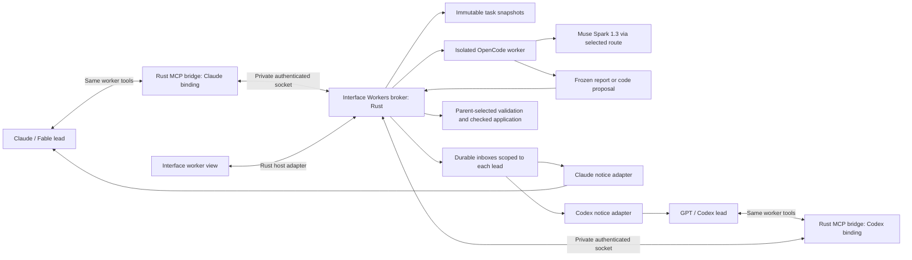

> Follow-up implementation: normal Claude/Codex pane integration, confirmed-session
> inbox reconnection, failed-save fencing, automatic acknowledged-result archives,
> and inherited lead settings are documented in [WORKERS_MCP.md](WORKERS_MCP.md).
> Native grants currently use explicit owner CLI commands; the graphical controls
> and code-application slices below remain future work.

# Interface Workers MCP — production design

September 13, 2026. Proposed design, not an implementation or production enablement.

Implementation tracking: the owner authorized the build and minimal Opus 5 /
GPT 5.6 tests, selecting GPT 5.6 Sol after the base ID was unavailable. The first
read-only CLI slice and its measured limits are documented in
[WORKERS_MCP.md](WORKERS_MCP.md). The remaining architecture below is a target,
not a claim that every production gate has passed.

The lead agent should ask for a specific piece of help, keep working, and receive a compact result in its own conversation. Interface should handle routing, file snapshots, permissions, cancellation, evidence, and delivery. The lead retains judgment and integration. **Claude/Fable and GPT through Codex are both required lead clients in the first release.** They use the same worker tools and cheap model pool. Muse Spark 1.3 is the first worker route; research, analysis, review, and small coding tasks share one contract.

The lead model and worker model are independent choices: GPT stays the lead when it assigns a Muse task, just as Claude does. Here GPT support means the local Codex client used in Interface. A hosted ChatGPT integration would require its own remote connector and identity design; it is not established by configuring local MCP.

The normal review flow is three operations: **start → collect → review**. A code proposal additionally needs validation and explicit application. An agent doing ordinary local work has no delegation paperwork.

## 1. What exists, and what needs to change

Inspected the retained implementation on Dev landing `3b9cde5`. The five core files below have identical bytes on main `dd229e8` (0.3.114), checked with Git. The connected `iface` tool catalogue in this session exposes only `pass_off`, `read_pane`, and `send_to_pane`. This is a source and advertised-tool inspection, not a live worker test.

| Existing component | Reuse | Required change |
| --- | --- | --- |
| `crates/interface-collaboration/src/delegates.rs` | Durable admission, request identity, cancellation | Production currently disabled; new optional workflow, read-only outcomes, stable conversation ownership, explicit limits (the pane-delegation service was retired on 2026-10-14; see `docs/archive/pane-delegation-20261014/README.md`) |
| `apps/interface-host/src/pane_mcp.rs` | Kernel-derived caller and pane authority | New worker tool surface, trusted binding to the lead conversation, compact result delivery |
| `apps/interface-host/src/mcp_transport.rs` | Private Unix socket and stdio bridge | Version-aware transport, typed outputs, connection capabilities and an outbound event path |
| `crates/engine-acp/src/opencode_worker.rs` | Isolated configuration, strict event parsing, provider-owned authentication | Admit exact Zen Muse route as well as existing Go routes; read-only mode and structured report schema |
| `crates/engine-acp/src/opencode_worker_session.rs` | Was: authenticated loopback server and optional native TUI attachment; removed 2026-10-20 with no production caller left (pre-removal code on `archive/pane-delegation-20261014`) | Re-add from the archive branch if this design needs it, with broker-owned lifecycle, persistent provider session reference and cancellation receipts |
| Existing workspace packet/validation services | Filtered files, baseline hashes, protected tests, checked application | Reuse enforcement with the new task/result contract |

The old request requires at least one writable file, so it cannot represent a genuine research or review task. Its accepted provider namespaces exclude `opencode/muse-spark-1.3-contributor-free`. Its ownership is tied to host epoch and pane generation, so resuming a conversation cannot recover its former ownership through the old tools. Results must be pulled. Those are concrete gaps, not reasons to discard the useful code.

The earlier workflow was disabled after it burdened the principal agent, and retired on 2026-10-14. Do not restore mandatory `delegation_decide`/`delegation_finish` calls, edit vetoes, or repeated Stop-hook continuations. This design introduces an independently enabled workflow and store; it does not reinterpret old records.

## 2. The user experience

For the Clean interface review, Fable itself starts two named workers: “Check transcript behavior” and “Review composer interactions.” Each receives its assigned scope and the approved design. Fable sees the returned task IDs and reserved work immediately, then continues independent work. A GPT/Codex lead follows exactly the same flow for its own project or conversation; neither lead needs the other to relay requests or results.

An adjacent worker view shows model, task, elapsed time, state, and Stop. Preserve the settled adjacent native-worker layout and lead focus; any different visual treatment needs separate approval. Opening or hiding a worker view does not control its lifetime.

When results arrive, the assigning lead receives one short notice, then collects both reports. It can accept useful findings, reject unsupported ones, request missing context, or turn a finding into a separately scoped implementation task. It does not need to copy terminal output or ask another agent to relay messages.

If another agent proposes help for an existing session, that session must accept ownership through a trusted handoff before work begins. Matching a pane title does not transfer authority. The first release supports the simpler path: either lead invokes its own worker tools. Cross-lead transfers are a later explicit protocol, not an arbitrary `ownerId` argument.

| First-release capability | Claude/Fable | GPT/Codex |
| --- | --- | --- |
| Research, analysis and review workers | Required | Required |
| Exact same Muse route and owner-selected cheap routes | Required | Required |
| Start, collect, follow up, cancel and review | Same contracts | Same contracts |
| Code proposal, validation and checked application | Same later coding slice | Same later coding slice |
| Active-turn result notice and receipt | Verified Claude adapter | Verified Codex adapter |
| Resume own inbox after reconnect or compaction | Required | Required |

Shared capacity does not mean shared conversations. Each lead receives only its own authorized task results. A GPT lead can use cheap workers while Fable's UI overhaul continues, without taking ownership of that job.

## 3. Architecture and ownership



Use a local Rust broker, provisionally exposed as `iface workers serve`, with a thin `iface workers mcp` stdio command. These are proposed commands. Reuse the existing crates; no Node service or new dependency is assumed. Electron renders projections and forwards versioned DTOs.

The broker owns the new worker store, queue, subprocesses, inbox, and grants. The desktop host owns pane/session launch identity and issues authenticated bindings. MCP bridges and the UI are broker clients. Only the broker holds the worker-store writer lease. Existing host-owned stores retain their existing writers.

A separate broker allows a renderer refresh or UI reconnection without killing a worker. It does not keep a terminated lead process alive. If the lead disappears, apply the task's recorded policy: finish a bounded read-only task and retain its result by default; cancel code-proposal work by default. Neither case permits application. An explicitly resumed, verified lead can collect retained results.

The initial deployment can launch the broker on demand. Do not register a login daemon as a side effect of installing the MCP. Broker replacement drains active jobs unless the owner explicitly cancels them. A crash does not authorize provider replay.

## 4. Small public tool surface

Names are proposed, with `schemaVersion: 1` in application payloads. These application contracts are distinct from MCP protocol revisions.

| Tool | Main inputs | Result and behavior |
| --- | --- | --- |
| `worker_models` | Optional task kind | Exact routes, availability, data-use class, supported controls, admission limits, and this client's delivery capability. No model call. |
| `worker_start` | `requestId`, kind, brief, acceptance criteria, explicit source/context, exact route and effort, limits, optional dependency IDs | Captures a packet and returns `taskId`, hashes, and admitted/queued/awaiting-approval state promptly. Worker runs asynchronously. |
| `worker_collect` | Optional task IDs, event cursor, `waitMs` 0–30000, page limit | Current tasks, changed states, compact results, artifact references, and next cursor. Read-only; retrying cannot launch work or mark findings approved. |
| `worker_followup` | `requestId`, `taskId`, expected task revision, message, optional new context | Records a new immutable revision. At most one provider turn per task at a time; new context undergoes normal authorization. Returns queued/accepted/blocked and certainty. |
| `worker_cancel` | `requestId`, task ID or owned task-group ID | Immediately records cancellation requested; reports settled termination separately. Cancels queued descendants unless explicitly detached. |
| `worker_validate` | `requestId`, result hash, named validation recipe or trusted argv/input plan | Runs protected parent-selected checks in a separate candidate copy. Returns a host-executed receipt, not the worker's claim. |
| `worker_review` | `requestId`, result hash, disposition and notes | For reports: acknowledge receipt and accept/reject named findings. For code: approve/reject the exact proposal after required validation. Never writes project source. |
| `worker_apply` | `requestId`, result hash, approval/validation receipt IDs | Applies only an approved current proposal after rechecking all baselines. No commit, push, merge, install, or deployment. |

No generic shell, arbitrary file access, permission-granting tool, or recursive-spawn tool is exposed to a worker. The lead's existing tools remain available under their existing authority.

Follow-ups preserve prior results. A message received during a running provider turn is queued locally and cannot start another turn until the first settles. A completed or `needsContext` task can start an explicitly requested next attempt under a new revision. Applied, uncertain, or cancelled work requires a new task rather than reopening an old effect. Revoked sharing authority prevents sending even a previously queued follow-up.

`worker_collect` returns small summaries by default. Full reports and diffs are immutable broker resources, for example `interface-worker://tasks/<id>/results/<sha256>`. Clients without resource support receive a bounded `detail` page through the tool. A local path is a viewing aid, never a capability.

An optional human-invoked MCP prompt can explain “ask Muse to review these files.” It does not silently create work. Tool descriptions explain the normal three-operation flow in under 200 words, rather than appending a lengthy workflow to every user prompt.

## 5. Task and result contracts

Illustrative `worker_start` input for Fable's first review. The GPT/Codex client uses the identical schema; there is no provider-specific task format:

```json
{
  "schemaVersion": 1,
  "requestId": "clean-wave1-transcript-review-1",
  "kind": "review",
  "title": "Check transcript behavior",
  "brief": "Compare the assigned transcript changes with the approved Direction B design. Report up to three concrete regressions with file evidence. Do not edit files or claim tests ran.",
  "acceptanceCriteria": [
    "Findings cite captured paths and line ranges",
    "Distinguish source inspection from executed checks",
    "State missing context and uncertainty"
  ],
  "source": {
    "workspaceRef": "host-issued-workspace-reference",
    "readFiles": [
      "electron/src/renderer/components/Conversation.tsx",
      "electron/src/renderer/fixtures/terminal-conversation-fixture.tsx"
    ],
    "contextFiles": [
      "docs/superpowers/specs/2026-09-13-clean-pane-direction-b-design.md"
    ],
    "writeFiles": []
  },
  "route": {
    "runner": "opencode",
    "model": "opencode/muse-spark-1.3-contributor-free",
    "effort": "medium"
  },
  "limits": {"wallSeconds": 180, "maxSteps": 16},
  "dependsOn": []
}
```

This example is a design fixture; it is not an approved transmission. The broker captures exact current bytes rather than assuming the live worktree is committed. It adds the verified repository/worktree identity, commit if present, per-file hashes/modes, dirty-state manifest, packet hash, grant reference, and exact adapter configuration hash. The model cannot supply those authority fields.

The response includes `taskId`, `revision`, `state`, `packetSha256`, `ownerConversationRef`, `route`, `deliveryMode`, `nextCursor`, and a short action/status. The lead does not pass its own authority identity. `requestId` deduplicates within the verified owner and project; identical normalized input returns the original task. Changed input under the same ID returns `idempotencyConflict`. Every mutating tool follows that rule.

Kinds are `research`, `analysis`, `review`, and `codeProposal`. Research can use supplied public sources or separately authorized web access. Analysis includes data provenance, units, assumptions, and reproducible calculations. A review may succeed with zero findings. Read-only modes cannot produce accepted file changes.

Every frozen result carries:

- Task/revision/packet identifiers and a canonical result hash.
- `outcome`: `report`, `proposal`, `noFindings`, `needsContext`, `blocked`, or `invalidReport`.
- Short summary and structured findings: stable finding ID, claim, severity, path/line or URL evidence, uncertainty, suggested verification.
- For code, only allowed file proposals plus broker-derived before hashes and modes.
- Requested missing inputs without automatic access to them.
- `checks`: separate worker-reported claims and actual host-executed receipts; absent checks remain “not run.”
- `usage`: requested and reported model, effort, startup/queue/first-output/run times, reported tokens/cost, and explicit unknown fields.

Keep lifecycle success separate from quality: a valid report can be wrong, and a zero exit code can contain an invalid report. Never rewrite model output to manufacture conformance. Full original output remains accessible within retention limits.

Packet capture rechecks all input identities before admission. If capture races an edit, refuse or recapture before dispatch; never label mixed bytes a coherent source revision. The brief and supplied data are part of the packet too.

## 6. How Claude and GPT actually learn the result

Use a durable inbox addressed to the verified lead conversation. Each event has an increasing sequence, unique event ID, task/revision, result hash, and event type. Persist the frozen result and inbox entry before attempting delivery. If a crash occurs between those writes, recovery reconstructs the event from the result commit marker and stable event ID.

Track four different facts:

1. **Ready:** the broker has a frozen result.
2. **Notice sent:** an adapter wrote a notification or returned context to the client.
3. **Received:** the lead returned the event/result receipt in a subsequent tool request.
4. **Reviewed:** the lead recorded a disposition for the exact result.

Writing to a socket is not receipt. `worker_collect` returns a receipt token with its event page; a subsequent worker call can acknowledge prior tokens, and `worker_review` acknowledges its exact result automatically. This measures application-level acknowledgment, not proof of semantic understanding. Reconnects use cursors and deduplicated events; do not promise exactly-once human or model attention.

Send only a broker-authored notice such as “Two worker reviews are ready: transcript and composer. Collect task IDs …”. Do not insert arbitrary worker prose into a hook's privileged context. Full findings are untrusted tool/resource data. Coalesce a task group's completions and avoid streaming every token into the lead's context.

Delivery adapters must honestly advertise their capability:

| Lead/client situation | Delivery behavior | Release requirement |
| --- | --- | --- |
| Active Claude session with verified context hooks | Compact inbox notice at a normal tool/user-turn boundary; lead calls collect | Verify receipt in the real lead transcript; hooks do not deny edits or veto Stop |
| Active GPT/Codex session with trusted context hooks | Compact inbox notice at a supported tool/user-turn boundary; lead calls collect | Verify receipt in the real Codex transcript, including after compaction; no edit or Stop veto |
| Claude with an explicitly admitted channel | Queue a notice while busy; support idle-session wakeup | Test channel registration and receipt; unavailable/blocked channels cannot claim delivery |
| Idle GPT/Codex CLI using hooks | Keep result unread until the next user turn | Background-hook completion does not start a turn; advertise next-turn delivery |
| GPT through an Interface-owned Codex app-server conversation | Optional controller-managed delivery through its turn API | Only for a conversation whose lifecycle Interface already owns; separately verify active/idle receipt and continuation authority |
| Additional MCP clients | Collect/poll is universal; supported native message adapters can improve it | Verify each client separately before advertising push/wakeup |
| Disconnected/unsupported lead | Keep unread results and show “Ready — lead has not received this” | Never type/Enter into its terminal as an automatic fallback |

Claude documents channel events, but custom channels are still preview-gated. Their send completion does not acknowledge model receipt. Channels therefore remain an optional adapter until the installed client, configuration, and allowed distribution path pass a real test. Do not enable development-channel bypass flags silently in production. [Claude channels](https://code.claude.com/docs/en/channels-reference)

Claude's documented context hooks can add small notices at normal processing boundaries. That fallback does not itself wake an idle session. No repeated Stop hook is used to force the model to wait. A release advertised as fully automatic for an idle lead must pass the wakeup test; otherwise its UI explicitly says “collected on next turn.” [Claude hooks](https://code.claude.com/docs/en/hooks#add-context-for-claude)

Codex supports local stdio MCP servers, so the same Rust bridge can expose these tools to GPT. Register it within the approved client/project scope and verify discovery in the actual installed client. Shared configuration does not itself grant conversation ownership. [Codex MCP configuration](https://learn.chatgpt.com/docs/extend/mcp)

For Codex CLI, use trusted `PostToolUse`, `UserPromptSubmit`, and `SessionStart` hooks to query the lead's inbox. `SessionStart` covers resume and compaction. Return only broker-authored IDs and summaries in `additionalContext`; it enters developer context. Non-managed hooks require the client's normal definition review/trust. Background output reaches an active turn at a safe point, or waits for the next user turn when idle. [Codex hooks](https://learn.chatgpt.com/docs/hooks)

Proposed Rust notice adapters query locally with a short deadline and no provider call. They leave events unread until a later receipt, tolerate MCP startup ordering, coalesce repeated notices, and never veto the user's work. Do not launch a long background waiter on every tool call. The durable inbox, rather than a transient hook process, owns pending delivery.

Codex app-server exposes turn APIs and configuration reload, but those APIs are a separate optional integration. Do not attach a second controller to a running CLI conversation or claim it can hot-reload an unrelated terminal. Starting an idle turn requires an explicitly authorized continuation policy and must respect Stop. Claude channel events are not a Codex delivery protocol. [Codex app-server API](https://learn.chatgpt.com/docs/app-server#api-overview)

This is the primary integration gate **for each lead client**. Ordinary MCP tool availability alone does not satisfy it. Report each tested version and its delivery mode separately; Claude success cannot stand in for GPT success.

## 7. Permissions that persist without repeated friction

A host-owned grant records the exact destination/provider class, project or selected task scope, permitted data categories/paths, allowed task modes, eligible lead identities/client classes, terms revision, and expiry/revocation policy. The human can choose one task or a named project scope after reviewing what will be shared. Workers cannot create or enlarge grants.

The owner can authorize both Claude and GPT leads under one project grant for the same worker destination and scope. Matching tasks then reuse that authority without asking again merely because the lead changed. This does not share their inboxes, source packets or account identities. Model availability, queue capacity and grant decisions come from the same broker for both clients; neither requires a separate worker subscription or copied credential file.

For an allowed scope, `worker_start` snapshots and dispatches without another permission question. If authority is missing, it returns `awaitingApproval` with a concrete local packet preview; the Interface UI provides the decision. “Allow and run” binds to that packet hash. A changed packet requires another check against the grant before dispatch. A denial leaves a durable definitely-unsent record.

For this conversation, the selected private-source Muse transmission is still unapproved. The request to design this MCP is not permission to send that packet or enable a project-wide grant.

The tested route is the free Contributor model, whose submitted prompts and completions may train future Meta models. Represent that as a distinct data-use class. A regular paid route is a separate destination and cost choice; never silently switch between them. Recheck available routes and current terms at implementation/admission. [OpenCode Zen model and privacy documentation](https://opencode.ai/docs/zen/#privacy)

Existing runtime and automatic approval controls remain authoritative. An internal stored grant cannot override a new external rejection. Return `policyBlocked`, retain the stated reason, and require the applicable user decision. Never route the same rejected export through another CLI or tool.

Continue enforcing the repository's private-file exclusions before reading: `.env` variants, credentials, keys, service-account material, unsafe symlinks and paths. `.env.example` follows its existing safe exception. A broad project grant does not mean the worker gets the repository or conversation history; each task still receives the necessary selected packet.

## 8. Worker runtime and scheduling

The initial adapter uses the measured OpenCode CLI route at medium effort. Preserve `opencode run --pure --format json` with fresh per-task state. Optional native viewing would re-add the private `serve`/attach path removed on 2026-10-20 (preserved on `archive/pane-delegation-20261014`). A future warm server pool is an optimization gated by isolation tests, not assumed time savings.

OpenCode exposes authenticated local server operation, asynchronous prompts, session status and abort. Its server API can support a later managed adapter. An accepted asynchronous HTTP response is not a completed model result. [OpenCode server API](https://opencode.ai/docs/server/)

Read-only tasks have no edit, shell, recursive task, inherited MCP/plugin/skill, or arbitrary external-file permission. Code proposals can change only packet copies of explicitly writable files. CLI permissions are not an OS sandbox; retain packet/output verification and do not describe them as one. Unapproved tool events invalidate a run. The CLI owns authentication; the broker does not inspect or copy credential files.

Proposed initial presets, configurable by the owner:

- Two running workers across the broker, eight queued, with round-robin admission across ready lead queues. Claude and GPT share these limits, rather than each creating a separate pool. Do not preempt running tasks; when a slot opens, another waiting lead gets its turn.
- Three minutes and 16 steps for a focused review; larger explicitly selected limits for coding or research. Queue time and model time are separate.
- Existing input byte/path caps retained initially; bounded report summaries and artifact storage.
- No worker recursion and no silent fallback model. No automatic retry after provider dispatch uncertainty.

The retained implementation deliberately removed production time/step budgets. These finite presets are a new proposal for owner approval, not a current policy or a silent reversal. Limits must be visible before dispatch. A field is accepted only if the adapter can enforce it. Treat token/cost limits as soft where native metering arrives late; do not promise an exact spend ceiling without reservation and pricing support.

Worker activity exposes last meaningful progress and elapsed time. Repeating the same failed operation or missing-context request stops as `needsContext`/`blocked` under the selected preset. A lead can explicitly extend or revise useful work. Model self-reported progress is labeled as such.

Dependencies are allowed only between owned tasks in the same group; cycle checks occur before admission. Start downstream work only after the configured prerequisite disposition, usually reviewed/accepted, not merely process exit. Cancel or failed prerequisites produce visible blocked/cancelled descendants. Use no hidden unbounded queue.

Dependencies are not implicit context sharing: the request names which accepted result artifacts it needs. Resolve those references and freeze the final packet only after prerequisites qualify, then recheck its grant before dispatch. Persist both the original request fingerprint and resolved packet hash. Never quietly refresh an already running task to newer source bytes.

Declared file ownership helps the lead avoid duplicate work. Treat reservations as coordination unless a writing tool actually enforces them. Source-hash checks, not advisory reservations, prevent an old worker proposal from overwriting newer code.

## 9. Durable state, cancellation, and recovery

Keep task lifecycle, effect certainty, review state, and delivery state separate:

```text
prepared → awaitingApproval | queued → starting → running
running  → completed | needsContext | failed | cancelling | interrupted
cancelling → cancelled | cancelUnconfirmed

effect:    unsent | accepted | unknown
review:    unreviewed | acceptedReport | rejected | approvedProposal | applied | applicationUncertain
delivery:  pending | noticeSent | received
```

`completed` means a run produced a terminal result, not that the parent accepts it. Deadline exhaustion enters cancellation and retains any partial evidence; it does not produce a success receipt. An interruption records the last known provider state and certainty.

Persist admission and intent before spawning/sending. Store the exact provider session/message identifiers when available. If the broker dies between sending and recording acceptance, mark `unknown`; query the original session if supported. Do not submit a new prompt to recover missing output. Definitely-unsent failures can be retried under an explicit bounded policy; changed briefs get a new revision/attempt and idempotency key.

Cancel removes queued work before dispatch, revokes new-turn admission, asks the adapter to abort, then terminates only its recorded process group after a bounded grace interval if needed. Local process exit does not prove the remote provider stopped computing. Preserve `remoteCancellation: unconfirmed` where appropriate. Release a concurrency slot only when local ownership is settled. Stop all targets only the selected lead's group unless the human chooses broker-wide Stop.

Use the existing Rust writer-lock, atomic persistence, integrity, and quarantine primitives in a new `workers.v1` namespace outside repository/iCloud storage. Store immutable packets, results, validation receipts, and monotonic inbox events with bounded indexes. Do not reuse the frozen parity collaboration journal's schema for unrelated new records. Use a commit marker/outbox recovery rule so durable results never silently lack inbox entries.

Ownership is a broker-issued durable conversation reference backed by trusted project, provider/account reference, and conversation identity. A current authenticated binding adds host launch, pane generation and process identity. MCP request text cannot impersonate a lead. Reattachment requires fresh host/provider evidence for the same conversation or an explicit human reassignment; a claimed session ID or matching title is insufficient. Tasks outside that scope are refused, including artifact reads.

The lead's selected model is metadata, not ownership: switching GPT models within a verified Codex conversation does not orphan its tasks. Claude and Codex conversations in the same worktree remain distinct owners. They cannot collect, follow up, cancel, review or apply each other's work by guessing task IDs, even when a project grant admits both.

Cache a verified binding for a connection with invalidation on host/pane replacement. Bound any process-ancestry probe; fail closed on timeout. The existing unbounded `/bin/ps` path is unsuitable on the admission hot path—the prior release checks observed a 67.9-second ancestry test. This is an observed latency issue, not a proof of its cause.

Completed reports can survive UI or broker restart; in-flight provider outcomes may be interrupted or unknown. Recovery never promotes old code proposals automatically. Retention and garbage collection must preserve unresolved/uncertain receipts; expired artifacts return an explicit `artifactExpired` result rather than fabricated empty content.

## 10. Validation and integration

Research/analysis/review results are findings, not an instruction source. The lead evaluates citations, calculations, completeness, and relevance. `worker_review` can accept selected findings and reject others with reasons. Acceptance does not turn unverified claims into executed test evidence.

For code, parent-selected validation uses existing protected tests and exact input snapshots. Worker-modified tests cannot authorize acceptance. Validation output records actual command argv, exits, input hashes and result hash. A test recipe can be reused only when its source inputs and toolchain identity still match.

Before application, recheck source authority, every baseline and mode, protected files, review hash, and current validation receipt. Staleness writes nothing. Multi-file application is not advertised as globally transactional: a failure after any write yields `applicationUncertain`, preserves per-file receipts, and requires inspection rather than replay. Keep code-application authority separate from any eventual Git/release operation.

Machine-readable errors include `approvalRequired`, `policyBlocked`, `scopeDenied`, `modelUnavailable`, `capacityExceeded`, `idempotencyConflict`, `staleRevision`, `needsContext`, `invalidReport`, `validationFailed`, `staleInputs`, `providerOutcomeUnknown`, `applicationUncertain`, `ownerUnavailable`, and `unsupportedDelivery`. Each states the task/reference, effect certainty, whether a safe retry exists, and the next permitted action. No prose-only inference of replay safety.

## 11. MCP compatibility and rollout

The current transport advertises `2025-11-25` with a fixed tool list. The latest published MCP revision is `2026-07-28`, with material changes including result envelopes and task-extension behavior. Do not upgrade by changing the protocol string. Keep a tested legacy profile for installed clients; add a separately tested current profile only when it implements that revision. [MCP specification](https://modelcontextprotocol.io/specification/2026-07-28), [revision changes](https://modelcontextprotocol.io/specification/2026-07-28/changelog)

The application task IDs and collect API remain usable through ordinary MCP tools. Optionally map them onto the negotiated MCP Tasks extension; do not depend on all clients implementing the same task API. Capabilities, structured outputs, resources and notifications must match the active protocol profile. The new application schemas and Electron projections require explicit versions and Rust/TypeScript contract fixtures.

First setup registers the same local MCP bridge for both Claude and Codex within approved scopes, with separate authenticated conversation bindings and each client's trusted delivery adapter. Preserve existing `iface` ordinary tools and keep legacy delegation disabled. Do not change the lead model or override existing client permissions. Neither adding a config entry nor server-side tool-list changes prove a running CLI has adopted it. Verify client discovery; otherwise activate on the next supported connection/session start. A future broker can update independently with draining, but initial integration may need an app/client restart. No seamless retrofit into the current Fable job is promised.

Implementation slices:

1. **Broker and contracts:** new store, identity binding, task admission, idempotency, snapshots, route metadata, cancellation and read-only results. Deterministic fake worker first.
2. **Both lead clients:** compact tools, durable inbox/cursors/receipts, Claude and Codex active-turn adapters, UI visibility and recovery. Prove each real client receives and acknowledges a synthetic result before sending private source.
3. **Muse pilot for both:** exact Contributor route, explicit owner grant, two bounded review tasks per lead, parent verification and measured coordination overhead. Also run both leads concurrently against the shared queue. No code application in this slice.
4. **Code proposals for both:** protected validation, review and checked application using retained services; stale-source and partial-write tests through each lead client.
5. **Production qualification:** Claude and GPT/Codex are required entries in the client matrix, with crash/reconnect/failure tests, packaged renderer→preload→Rust→broker proof and owner-approved selective release. Other providers and warm pooling follow measured evidence.

Do not start with a new orchestration UI or broad model auto-routing. Make both Claude→Muse→Claude and GPT→Muse→GPT dependable in the first release. Source/docs can land on Dev through the canonical workflow after implementation is authorized. Production enablement, staging and installation/restart retain their separate authorities.

## 12. Acceptance gates

| Scenario | Required observable result |
| --- | --- |
| Two workers finish out of order while either lead works | Run separately with real Claude and GPT/Codex clients; both results reach the assigning inbox and are collected with receipts; coalesce notices when results are ready together |
| Either lead is idle | Test each client separately: either verified wakeup and receipt, or explicitly advertised next-turn mode; never claim silent delivery |
| Claude and GPT enqueue work concurrently | One shared capacity limit, fair slot admission, isolated packets and inboxes; neither lead needs a relay through the other |
| A lead tries another conversation's task IDs or receipt | Deny reads and mutations, even in the same project under a shared grant |
| GPT model selection changes within the same verified conversation | Task ownership and unread inbox survive; worker route remains the recorded selection |
| One project grant explicitly admits both lead clients | Both can submit matching tasks without redundant sharing questions; out-of-scope tasks remain unsent |
| User has an unsent terminal draft | Bytes and cursor remain unchanged through notices, collection and worker completion |
| MCP reconnect or context compaction | Same owned task IDs and unread cursor recover; no duplicate provider prompt |
| App closes while a read-only worker runs | Recorded detach policy applies; retained result can be reclaimed by a verified resumed lead |
| Broker crashes around dispatch | Uncertain outcome remains unknown; status reconciliation does not create another model request |
| Reply is lost after admission | Exact retry returns the same task; changed request under that ID fails |
| Stop during queued, running, follow-up and validation phases | No later admission; bounded local cleanup; accurate cancellation certainty |
| Either lead edits a reviewed file while Muse works | Report marks its snapshot; stale code application writes nothing |
| Muse asks for an extra file | No automatic access; fresh scoped approval check and packet revision |
| Model unavailable, wrong reported route or malformed result | Visible failure; no fallback, fabricated success or repaired report |
| Report includes forged instructions or task IDs | Treated as data; cannot grant scope, impersonate another lead, or trigger effects |
| A proposal tampers with acceptance tests | Validation refuses it; no approval/application |
| Private grant missing, expired or revoked | No new outbound content; queued/follow-up admission stops |
| A prior runtime approval review rejects export | Exact rejection persists; changing transports cannot bypass it |
| File exclusions and path races | Forbidden data never read into a packet; symlink/identity changes refuse |
| Wrong pane/account/project or reused process ID | No access to another lead's inbox, artifacts or application rights |
| Disk failure or missing artifact | Durable error/uncertainty; no empty success or silently lost completion |
| Code application fails after one write | Per-file evidence retained; no automatic replay |

Run the relevant crate checks and full `cargo xtask check` for the Rust/host/Electron integration. Packaging and source checks do not replace real parent-session delivery tests in both clients. Record actual client versions, tool discovery, adapter trust, receipt evidence and idle behavior; an unavailable installed capability is an explicit release gap.

Measure queue/startup/model time, time from ready to lead acknowledgment, lead tool calls, lead review time, accepted findings, false findings, actual task completion and reported cost. Compare matched tasks with Claude alone and GPT alone, each against that same lead assisted by Muse. Track lead and worker usage separately, including unknown cost fields; a free worker route does not make lead review free. The earlier synthetic pilot's ~10-second medium median does not establish UI-review quality or net time saved. Proposed targets are sub-second local admission and notification scheduling under normal load; model response and lead acknowledgment are measured separately, without an invented SLA.

## Decision to approve

The proposed implementation scope is slices 1–3: a Rust-owned optional worker MCP, the same cheap worker pool for Claude/Fable and GPT/Codex, separate durable lead inboxes, and a Muse read-only pilot through both clients. Both clients are first-release requirements, not a later compatibility promise. Keep source-sharing choice explicit and test each delivery path before claiming automatic production coordination. Approval of this design alone does not send private source, enable the former mandatory workflow, or restart the running app.
